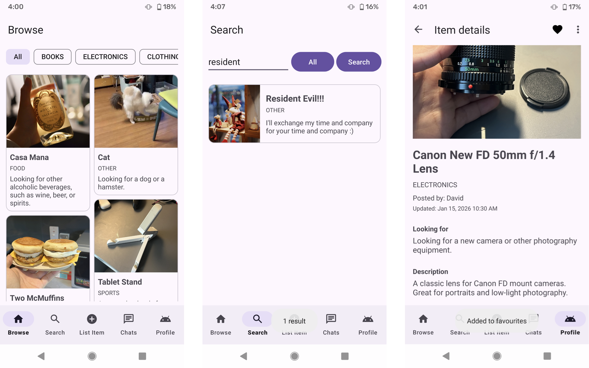
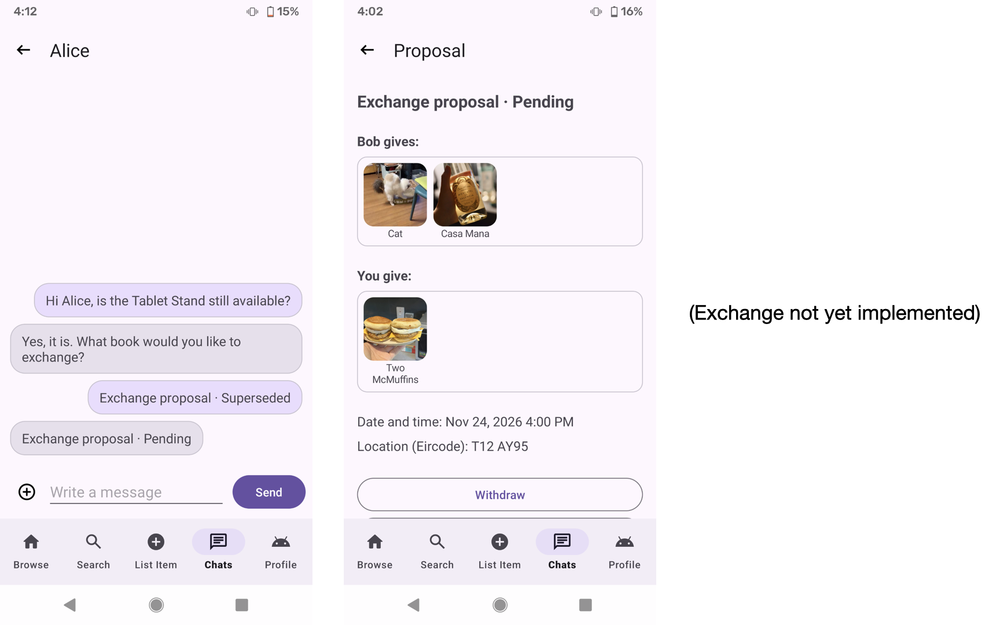
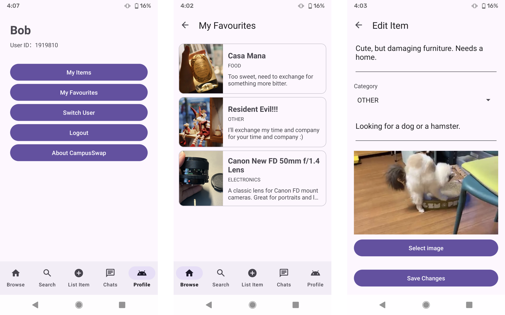

# CampusSwap

A Campus Second-Hand Exchange App

Xiaoruikang Ding 123115939

Zixuan Liu 123107277

CS4415 - Mobile Applications Design







## App overview

CampusSwap is a university course project: an Android app for college students to exchange second-hand items on campus. Users can post items, browse and favourite items, negotiate exchange proposals through chat, and after a proposal is accepted, arrange an offline handover and confirm completion by both sides.

### Problem Background

When courses end, students move dormitories, or graduate, they may have items they no longer use but which still have value, such as textbooks, stationery and daily necessities. At the same time, other students may need these items and be willing to exchange their own unused items.

If exchanges are organised through group chats, item information is easily buried by later messages. Users also need repeated communication to confirm what the other side wants, whether the item is still available, and the handover time and place. When the same item is involved in several negotiations at the same time, the exchange conditions may become inconsistent, or the same exchange may be agreed more than once.

CampusSwap addresses these scenarios by providing a central place to display items, negotiate proposals and confirm handovers.

### Target Users

The main target users are college students who want to exchange second-hand items on campus. A user can both post their own items and browse other people's items.

Typical scenarios include:

- After a semester ends, a student wants to exchange textbooks they no longer need for books needed in the next semester.
- Before moving dormitory, a student wants to exchange unused daily items to classmates who need them.
- A student browses campus items and proposes an exchange using one or more of their own items.

The project assumes that users have basic Android phone skills and are willing to arrange the offline handover on campus themselves. The app does not handle payment, delivery or dispute resolution.

## How to run

1. Use Android Studio 2026.1 to open the `campus-swap` directory, use JDK 21, and wait for Gradle to finish syncing.
2. Select the `Pixel_7` AVD (API 37, android-37.2, arm64-v8a) and run the `app`. The project uses compileSdk 37 / minSdk 24 / targetSdk 37.
3. On first launch, the database is empty, and the app will write sample data from `SampleData`. Switch demo identities on the Profile page.
4.  Uninstall and reinstall the app or clear app data to reset the database. Sample data will be written again on next launch.

## Main features

### Item Posting and Management

Users can:

- browse the item list and see images, categories and exchange wishes
- search by title and filter by category
- view item details
- post, edit and withdraw their own items
- favourite other users' items

A posted item contains a title, description, category (enum), wanted item (string) and one image. The image is selected through the system photo picker, and a copy is saved locally.

Only `AVAILABLE` items can be edited or withdrawn by the owner. Items that have entered the agreed handover stage are marked `RESERVED` and cannot be edited or withdrawn, to avoid changes to exchange conditions already confirmed by both sides.

When item content actually changes or the item is withdrawn, the item is updated in the same database transaction and all `PENDING` proposals containing the item are marked `INVALIDATED`. Saving without changes does not increase the revision and does not trigger invalidation. Proposals that are accepted, rejected, withdrawn or superseded keep their original status.

### Chat and Editing Exchange Conditions

- Users can start a new Chat from another user's item detail page or the home page.
- When starting a new conversation, the initiator needs to edit a Proposal, add several of their own posted items, and select some items from the other side's inventory. The Proposal also includes the exchange time and place (Eircode). After confirming, the Proposal is locked and sent to the other side.
- The other side can accept, reject, or modify the Proposal, lock it and send it back to the requester.
- Both sides can continue the conversation during this period.
- An invalid proposal in the chat is shown as `Exchange proposal - Invalid`. The top of the proposal detail shows the same status and the message `One or more items have been modified or withdrawn since this proposal was created.`
- An invalid proposal is read-only and cannot be accepted or directly edited and resent. Both sides can select items again from "Create Proposal" in the chat and send a new proposal.
- The above steps can be repeated until one side agrees. Then an Exchange record is created and both sides wait for the offline handover.

### Proposal Versions and Item Reservation

- **When sending a Proposal**: that version fixes the list of item IDs, the provider and revision at sending time, and the handover time and place. Items in the proposal can still take part in other negotiations and are not reserved at this point.
- **When displaying a Proposal**: the current Item is read by item ID, and the latest title, image and status are shown. Tapping the image opens the current item detail. Withdrawn, reserved or exchanged items remain in the proposal list and show their status. Historical proposals also read the latest item information. Item content snapshots from sending time are not displayed.
- **When editing or withdrawing an item**: all related `PENDING` proposals become `INVALIDATED` in the same transaction. Other final states do not change. If the item becomes available again later, old proposals do not become valid again.
- **When modifying a Proposal**: a new version is created and sent based on the old version. The old version is kept as history but can no longer be accepted. Only the latest pending version can be accepted.
- **When accepting a Proposal**: check that the proposal is still the latest `PENDING`, then check again that all items in both sides' lists are still `AVAILABLE`, and that ownership and revision match the records at sending time. If all checks pass, in the same database transaction mark the Proposal `ACCEPTED`, create an Exchange with status `AWAITING_HANDOVER`, reserve all related items (set them to `RESERVED`), and mark other pending proposals containing any of these items as invalid. If a check fails, the proposal is not accepted and no items are reserved.

### Confirming Completion

After the offline handover, both sides tap "Confirm handover" on the exchange detail page, and all related items are marked as exchanged.

### Profile Page

Shows the current demo identity and provides:

- My posted items -> detail, edit, withdraw
- My favourites
- Demo identity switching
- About the app

## App structure

```
MainActivity
- Browse
    - top category filter -> recent items or selected category item list -> item detail
- Search
    - top search box -> enter keyword -> search result list -> item detail
- List
    - post item
- Chats
    - conversation list -> chat detail
        - text messages and historical proposal cards
    - edit exchange list, time and Eircode -> send Proposal
    - accept, reject, withdraw or send a modified version
    - accepted proposal -> Exchange detail, cancel or confirm handover
- Profile
    - my posted items -> detail, edit, withdraw
    - my favourites -> item detail
    - switch demo identity
    - about
```

## Data handling

- **Initial data**: when the database is empty (first installation or after clearing app data), the first database access writes the sample items, favourites, conversations, proposals, proposal items and messages from `SampleData`. A normal restart does not import them again
- **Persistence**: items, favourites, conversations, messages and proposals are written to the local Room database. The current demo identity is stored in SharedPreferences, and images selected by the user are stored in the app's private directory

## Technical implementation

- **Language and UI**: Kotlin + XML/View
- **Screens and navigation**: single Activity, multiple Fragments, Navigation Component
- **Lists**: RecyclerView + custom adapter
- **UI architecture**: MainActivity uses AppCompatActivity and setContentView to load XML. The five main screens use Fragments. The bottom bar uses Material BottomNavigationView and is connected to the NavController through NavigationUI
- **Code layering**: `model` / `data` / `ui` three layers

### Application Structure and State Management

- `model/`: data classes and enums such as Item, User, Conversation, Proposal, ProposalItem, Exchange, Message and Favourite.
- `data/`: `CampusSwapDatabase`, DAOs, repositories (`object` singletons), `SampleData`, `UserSession` and `ItemImageStorage`.
- `ui/`: Fragments under `screens/`, `adapters/`, `theme/`, `NavigationConfig` and `ItemImageLoader`.

Startup chain: `CampusSwapApplication.onCreate()` initialises `CampusSwapDatabase` and `UserSession` -> `MainActivity` loads `activity_main` -> `NavHostFragment` uses `nav_graph` to host the five main screens -> `BottomNavigationView` is connected to `NavController` through `NavigationUI`.

Data flow: Fragment -> Repository -> DAO -> Room. Repositories use `suspend` functions and `withTransaction` for reads and writes, and Fragments call them in `viewLifecycleOwner.lifecycleScope` and refresh the UI. Room stores items, favourites, conversations, messages, proposals and exchanges. Images are stored in `filesDir/item_images`.

State and lifecycle: screens query Room again when they are created, and UI state is kept inside the Fragment. ViewModel is not used at present. This keeps the layering simple, but the cost is that temporary state in Fragment memory is not restored after rotation or process death, and the user needs to query or fill it again.

## Testing

- Main flows: Browse category filtering and detail; Search and empty results; List posting/editing/withdrawing (including images); Chats text/image messages and Proposal creation/modification/rejection/withdrawal; Profile favourites, my items, identity switching and About.
- Key exceptions: empty forms; editing or withdrawing another user's or a `RESERVED` item; Proposal with an empty list, past time, empty Eircode, or changed items; no identity selected; rotation/process restart; empty states of each list.

## Limitations and future improvements

### Limitations and Known Issues

- **Proposal edit drafts are not persisted**: the item list, handover time and Eircode being edited are only kept in Fragment memory variables and are written to the database only after sending. After leaving the page, the draft cannot be restored and must be created again.
- **Temporary state after rotation/process restart is not fully restored**: the selected image when posting or editing an item, the item selection and time/place in proposal editing, etc. only exist in Fragment memory. After screen rotation or process death, they need to be selected or filled again.
- **Image files are not cleaned up**: after a user-selected image is copied to `filesDir/item_images`, old files are not deleted when the image is replaced or the item is withdrawn. The database only stores the path, so old files continue to take up storage space.

### Features Not Included in the First Version

The following features are listed as future improvements:

- user reviews
- account registration
- real-time chat
- payment, deposit and price difference
- preset campus exchange locations
- reporting, dispute resolution and admin backend
- real-time location
- smart recommendations